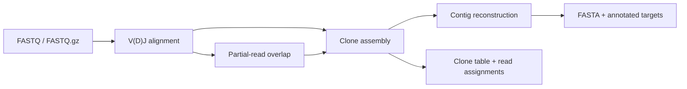

<div align="center">

# Biosoft · MiXCR Python
**From immune-receptor reads to inspectable clonotypes.**

[English](README.md) · [简体中文](README.zh-CN.md)

Python 3.10+ · Version 0.2.0 · MiXCR 3.0.13 research reconstruction

[Usage](docs/usage.md) · [Validation](docs/validation.md) · [Latest official version](docs/latest-version.md)

</div>

---

A Python implementation of human V(D)J alignment and clonotype reconstruction. Read FASTQ files, inspect V/D/J/C assignments, assemble clones, and reconstruct contigs with transparent JSON, TSV and FASTA outputs.

Core algorithms run in Python with NumPy and bundled references. Java is used separately for optional comparisons with the original MiXCR 3.0.13 program.

> **Research scope.** The validated target is **3.0.13**, using selected human reference and parameter profiles. The upstream research license restricts eligibility and use; see [License](#license). This project is independent of MiLaboratories.

## The workflow



| Capability | Available in this release |
| :--- | :--- |
| Input | Single or paired FASTQ, including gzip |
| Alignment | Human TCR/BCR genes, V/D/J/C hits, scores and feature coordinates |
| Clones | CDR3 and selected multi-feature assembly; quality-aware mapping and clustering |
| Paired reads | Overlapping or unmerged pairs, Opposite layout |
| Partial reads | Overlap assembly with contributing read IDs |
| Contigs | Default CDR3-clone reconstruction with annotated branches |

## Quick start

```bash
git clone https://github.com/thekingofall/Biosoft-Project-MiXCR-Python.git
cd Biosoft-Project-MiXCR-Python
python -m venv .venv
```

Activate with `source .venv/bin/activate` on Linux/macOS or `.venv\Scripts\Activate.ps1` in Windows PowerShell, then run:

```bash
python -m pip install ./python
python -m mixcrpy analyze examples/trb.fastq results/single --chains TRB
python -m mixcrpy analyze examples/trb_R1.fastq results/paired --read2 examples/trb_R2.fastq --chains TRB
python -m mixcrpy assemble-contigs results/single.alignments.json results/single.clones.json results/contigs
python scripts/check_example.py results
```

The bundled example contains **20 synthetic reads from two TRB templates**. The verified result is two clones with counts **12 and 8**, and two contig branches. The sequences come from the bundled reference and contain no patient information.

For your own reads:

```bash
mixcrpy analyze reads_R1.fastq.gz results/sample --read2 reads_R2.fastq.gz --chains TCR
```

Use a new output prefix for each run. Add `--force` when replacing an existing run.

## Read your results

| File suffix | What it tells you |
| :--- | :--- |
| `.clones.tsv` | Clone abundance, V/D/J/C hits and CDR3 sequence |
| `.read-assignments.tsv` | The clone or rejection reason for each input record |
| `.alignments.tsv` | Gene hits, scores, CDR3 and status for each record |
| `.report.json` | Read counts, assembly statistics and settings |
| `.alignments.json`, `.clones.json` | Structured intermediates for separate steps |
| `.contigs.fasta`, `.contigs.tsv`, `.contigs.json` | Reconstructed sequences, annotations and branch details |

[The usage guide](docs/usage.md) covers paired headers, multi-feature assembly, partial reads, contigs and troubleshooting.

## Evidence and limits

Six FASTQ comparisons against the original 3.0.13 program showed **zero differences in the fields checked**. They cover synthetic TRB and upstream TRB/IGH examples, single and paired reads. Separate comparisons cover partial assembly, multi-feature assembly and contigs. The portable test suite and captured original-program expectations are included.

```bash
python -m pip install pytest
python -m pytest python/tests -q
```

The [validation report](docs/validation.md) lists datasets, measured fields, results and limits. To compare the bundled example with your own original 3.0.13 JAR, follow [the comparison instructions](docs/usage.md#compare-with-the-original).

Validation covers finite datasets and selected profiles. Other species, arbitrary scoring, KAligner2, alternative paired layouts, single-cell barcode processing, allele inference and SHM trees are outside the supported interface. Native MiXCR binary files (`.vdjca`, `.clns`, `.clna`) are not accepted by this Python CLI. The CLI holds alignments in memory; size a pilot run before using large datasets. Clinical validation and production-scale performance have not been established.

## Which version?

| This project | Official MiXCR |
| :--- | :--- |
| Python package **0.2.0** | Latest stable GitHub release checked: **4.7.0** |
| Compatibility target **3.0.13** | Published **7 August 2024** |
| Human references exported from repseqio.v1.6 | Newer features described in [version notes](docs/latest-version.md) |

The latest-release check was made on **12 October 2026**. This repository contains the older research reconstruction and a sourced overview of the newer release.

## License

MiXCR/MiLib-derived portions retain the original [research license](LICENSE), including its restriction to educational, research and nonprofit purposes **by nonprofit institutions**. Commercial use requires separate permission from the upstream licensor. Public visibility does not expand these rights.

WELL19937c-derived code retains the Apache Commons Math notices and Apache 2.0 terms. See [NOTICE](NOTICE), [third-party license](python/mixcrpy/data/LICENSE.apache-2.0) and [provenance](docs/provenance.md).

---

[Official MiXCR](https://github.com/milaboratory/mixcr) · [3.0.13 source](https://github.com/milaboratory/mixcr/tree/v3.0.13) · [Report an issue](https://github.com/thekingofall/Biosoft-Project-MiXCR-Python/issues)
