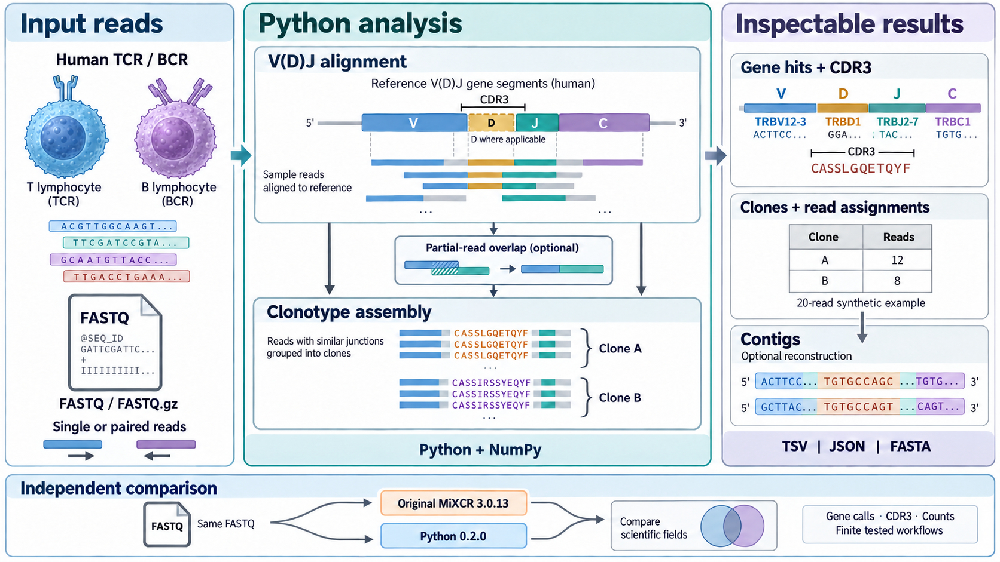

<div align="center">

# Biosoft · MiXCR Python
**从免疫受体测序 reads，到可查看、可追溯的克隆结果。**

[English](README.md) · [简体中文](README.zh-CN.md)

Python 3.10+ · 版本 0.2.0 · MiXCR 3.0.13 科研重建

[完整用法](docs/usage.zh-CN.md) · [验证报告](docs/validation.zh-CN.md) · [官方最新版说明](docs/latest-version.zh-CN.md)

</div>

---

这个项目用 Python 实现人类免疫受体的 V(D)J 比对和克隆重建。从 FASTQ 出发，可以查看 V/D/J/C 基因命中、组装克隆、拼接部分 reads，并导出 contig。结果保存为便于检查的 JSON、TSV 和 FASTA。

核心算法在 Python 中运行，依赖 NumPy 与随包参考序列。原版 Java 程序用于独立对照测试。

> **科研适用范围。** 当前验证目标为 **3.0.13**，覆盖指定的人类参考序列和参数配置。原版科研许可对使用主体与用途有要求，详见[许可](#许可)。本项目独立于 MiLaboratories。

## 分析流程



*流程总览。图中的基因名称与序列用于示意；克隆计数 12 和 8 来自仓库随附的 20 条合成 reads 示例。* [下载 PDF](docs/figures/workflow.pdf)

**从 reads 开始。** 输入人类 TCR/BCR 的单端或双端 FASTQ。程序寻找匹配的 V/D/J/C 基因片段，并识别 CDR3 连接区；部分受体链由 V、J 重排形成，不包含 D 片段。

**得到克隆与序列。** 组装步骤将 reads 归入克隆，同时记录每条 read 的去向。部分读段重叠拼接和 contig 重建可以按需加入。克隆表用于查看丰度，注释序列用于检查具体重建结果。

**理解验证依据。** 下方流程将同一份 FASTQ 分别交给原版 3.0.13 与 Python 实现，再比较科学结果字段。这是开发阶段的独立对照，证据范围见验证报告中的具体数据集与配置。

| 能力 | 当前支持 |
| :--- | :--- |
| 输入 | 单端、双端 FASTQ，支持 gzip |
| 比对 | 人类 TCR/BCR 基因、V/D/J/C 命中、分数与特征坐标 |
| 克隆 | CDR3 与指定多特征组装，质量感知的映射与聚类 |
| 双端 reads | 重叠合并和保留双目标，Opposite 布局 |
| 部分 reads | 重叠拼接，并保留参与拼接的 read ID |
| Contig | 基于 CDR3 克隆的默认重建流程与分支注释 |

## 快速开始

```bash
git clone https://github.com/thekingofall/Biosoft-Project-MiXCR-Python.git
cd Biosoft-Project-MiXCR-Python
python -m venv .venv
```

Linux/macOS 使用 `source .venv/bin/activate` 激活；Windows PowerShell 使用 `.venv\Scripts\Activate.ps1`。随后安装并运行示例：

```bash
python -m pip install ./python
python -m mixcrpy analyze examples/trb.fastq results/single --chains TRB
python -m mixcrpy analyze examples/trb_R1.fastq results/paired --read2 examples/trb_R2.fastq --chains TRB
python -m mixcrpy assemble-contigs results/single.alignments.json results/single.clones.json results/contigs
python scripts/check_example.py results
```

示例包含两个 TRB 模板生成的 **20 条合成 reads**。经核验，得到 **12 和 8** 两个克隆计数，以及两个 contig 分支。示例序列来自随包参考库，不含患者信息。

换成自己的数据：

```bash
mixcrpy analyze reads_R1.fastq.gz results/sample --read2 reads_R2.fastq.gz --chains TCR
```

每次运行使用新的输出前缀；需要替换已有结果时添加 `--force`。

## 怎么看结果

| 文件后缀 | 内容 |
| :--- | :--- |
| `.clones.tsv` | 克隆数量、比例、基因命中与 CDR3 序列 |
| `.read-assignments.tsv` | 每条输入记录所属克隆或未纳入原因 |
| `.alignments.tsv` | 每条记录的基因命中、分数、CDR3 与状态 |
| `.report.json` | 输入数量、组装统计与参数 |
| `.alignments.json`、`.clones.json` | 分步流程使用的中间结果 |
| `.contigs.fasta`、`.contigs.tsv`、`.contigs.json` | 重建序列、注释与分支详情 |

双端名称规则、多特征组装、部分 reads 拼接与常见问题见[完整用法](docs/usage.zh-CN.md)。

## 验证到了什么程度

六组 FASTQ 与原版 3.0.13 对照，**已检查字段的差异均为 0**。数据包括合成 TRB 和上游 TRB/IGH 示例，覆盖单端与双端。另有部分 reads、多特征组装与 contig 的独立对照。仓库提供可重跑的测试和原版程序的固定预期结果。

```bash
python -m pip install pytest
python -m pytest python/tests -q
```

[验证报告](docs/validation.zh-CN.md)列出了数据量、检查字段、结果与边界。也可以使用自己的原版 3.0.13 JAR，按[对照说明](docs/usage.zh-CN.md#与原版对照)重跑随附示例。

验证覆盖有限数据集和指定配置。其他物种、任意评分规则、KAligner2、其他双端布局、单细胞条形码处理、等位基因推断与 SHM 树目前不在支持接口内。Python 命令行使用自有 JSON 中间格式，暂不读取原版 `.vdjca`、`.clns`、`.clna` 文件。比对记录保存在内存中，大数据应先以小样本评估资源需求。临床适用性与生产规模性能尚未验证。

## 版本说明

| 本项目 | 官方 MiXCR |
| :--- | :--- |
| Python 包 **0.2.0** | 查询到的最新稳定 GitHub 版本 **4.7.0** |
| 行为对照版本 **3.0.13** | 发布于 **2024 年 8 月 7 日** |
| 人类参考序列来自 repseqio.v1.6 | 新功能见[最新版说明](docs/latest-version.zh-CN.md) |

最新版核对日期为 **2026 年 10 月 12 日**。公开仓库包含旧版科研重建和有官方来源的新版功能说明。

## 许可

MiXCR/MiLib 衍生部分保留[原版科研许可](LICENSE)：授权范围涵盖**非营利机构**的教育、研究和非营利用途。商业用途需要向上游权利方另行取得许可。仓库公开可见，适用的许可条件仍然有效。

WELL19937c 相关实现保留 Apache Commons Math 声明及 Apache 2.0 条款。详见 [NOTICE](NOTICE)、[第三方许可](python/mixcrpy/data/LICENSE.apache-2.0)与[来源记录](docs/provenance.md)。

---

[官方 MiXCR](https://github.com/milaboratory/mixcr) · [3.0.13 源码](https://github.com/milaboratory/mixcr/tree/v3.0.13) · [反馈问题](https://github.com/thekingofall/Biosoft-Project-MiXCR-Python/issues)
